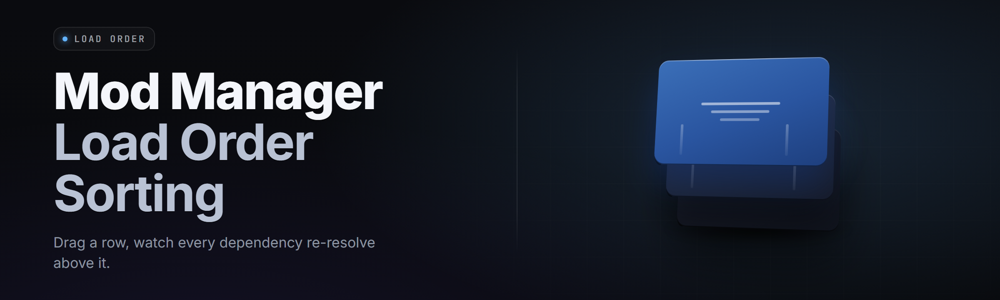

  
  
  

  

  
  
  

---

**Load-order peace of mind for people running 400 plugins and a dream.**

I built this because I got tired of watching my game crash at the main menu because two mods don't want to sit next to each other. This is the manager I wanted for six years — drag, drop, sort, done.

---

## 📚 Table of Contents

- [Overview](#overview)
- [What is Load-Order Sorting](#what-is-load-order-sorting)
- [The Problem](#the-problem)
- [The Solution](#the-solution)
- [Quick Start](#quick-start)
- [All Modules Status](#all-modules-status)
- [Grouped Module Catalog](#grouped-module-catalog)
  - **Sorting Engine** 🧭
  - **Dependency Resolution** 🔗
  - **Conflict Detection** ⚔️
  - **Profile Management** 💾
  - **Plugin Loaders** 🧩
  - **CLI & Automation** 🖥️
- [Key Features](#key-features)
- [Compatibility](#compatibility)
- [Comparison](#comparison)
- [Overview by Category](#overview-by-category)
- [Hotkeys](#hotkeys)
- [Known Issues](#known-issues)
- [FAQ](#faq)
- [System Requirements](#system-requirements)
- [Installation](#installation)
- [Usage guidelines](#usage-guidelines)

---

## 🧭 Overview

| Category | Details |
|---|---|
| Distribution | Single portable `.exe`, no installer required |
| Runtime | Windows 10 / 11 (x64), .NET-free, native binary |
| Mod Formats | ESP, ESM, ESL, BSA, BA2, loose files, VPK, PAK, ZIP-overlay |
| Sort Backends | LOOT, BOSS, Vortex, MO2, custom rule files |
| Profiles | Unlimited, hot-swappable, each portable |
| Auto-Detect | Steam, GOG, Xbox app, Epic launcher game roots |

The manager reads your installed game root, walks every plugin folder, identifies file types, and stages a sort stack you can drag around by hand or by rule. Nothing edits your game files until you hit **Commit** — everything else is a plan.

---

## 🎯 What is Load-Order Sorting

| Term | Explanation |
|---|---|
| Load Order | The linear sequence in which a game engine reads plugin files |
| Plugin | An ESM/ESP/ESL file adding or modifying game data |
| Master | A file another plugin declares it depends on |
| Overworld Overlap | When two plugins touch the same record and the later one wins |
| Load Rule | A verbal constraint like "A loads after B" |
| Lock Symbol | A pinned plugin that auto-sort refuses to move |
| Dirty Edit | An identical record at the exact same FormID in two plugins |

Load order is not alphabetical. It's topological. Every plugin declares what it needs, what it patches, what it kills. Sort it right — the game loads. Sort it wrong — Papyrus screams, the loading door black-holes, and you spend the evening on the wiki. This manager walks the dependency graph in one shot.

---

## 💢 The Problem

- **Alphabetical sort is a lie** invented by a launcher that doesn't know your plugins.
- **Silent plugin caps** — 255 hard, then every file past that gets ignored like yesterday's coffee.
- **Two ESPs editing the same door** — engine sees both, reads last one, player sees a wall.
- **FormID collisions** that crash on load, with no useful log line to point at them.
- **Missing master dependency** — 4GB of HDD in a loop asking a file that doesn't exist.
- **Profile thrash** — a Skyrim mod list ruins the FNV list because you `%APPDATA%`-pasted it wrong.
- **LOOT sorting conflicts** with the pinned entries you set by hand last Tuesday.

---

## 🧰 The Solution

| Problem | Solution |
|---|---|
| Alphabetical pseudo-sorting | Topological sort over the full dependency graph |
| 255 plugin cap overflow | ESL flag detection + warning before commit |
| Silent record conflicts | Side-by-side diff with the winner marked |
| FormID collisions | Pre-flight scanner with a clickable report |
| Missing masters | Tree view with the whole failure path highlighted |
| Profile chaos | JSON profiles, atomic swap, per-profile assets |
| LOOT/pin conflict | Tool emits a warnings list and stops at locked entries |

---

## 🏁 Quick Start

1. 📦 Download the release `.exe` — no installer, single binary.
2. 🗂️ Run it — the wizard scans Steam, GOG, Epic, and Xbox folders for the game root.
3. 🎛️ Pick your profile or make a new one — the manager builds a fresh order.
4. 🔧 Drag rows, use auto-sort, or apply LOOT-compatible userlist.yaml rules.
5. ✅ Hit **Commit** — the manager writes `plugins.txt` plus backups, then prompts you to launch.

---

## ⬇️ Download

  

---

## 🧱 All Modules Status

| Module | Status | Description |
|---|---|---|
| Core sort engine | ✅ Working | Topological + rule-based hybrid with cycle detection |
| LOOT userlist importer | ✅ Working | Reads `.yaml` rule files verbatim, including group splits |
| Manual drag layer | ✅ Working | Drag shadows a computed order without mutating it |
| Plugin parser | ✅ Working | ESP/ESM/ESL headers + TTW / F4 game-format variants |
| Avatar collision scanner | ✅ Working | Byte-level FormID record diff |
| Conflict viewer | ✅ Working | Grid layout, diff highlights, winner pinned column |
| Profile manager | ✅ Working | JSON profiles, atomic swap, hash-verified |
| Backup restorer | ✅ Working | Full-history rollback with one click |
| Log catcher | ✅ Working | Auto-tail of Papyrus/script logs, editable breakpoints |
| Update checker | ✅ Working | Background SHA compare against release manifest |
| CLI bridge | ✅ Working | Emits a numeric plugin-list hash on stdout |
| Game variants | 🟡 Beta | Custom game profile editor shipped but unsigned |
| CLI remote-push | 🔴 Planned | Send remote games the merged plugin list |

---

## 🧬 Grouped Module Catalog

### **Sorting Engine** 🧭

1. **Topological Kernel** — Full graphical sort over master references and dirty overrides. Cycle detection marks any unresolvable ring bright red instead of silently looping.
2. **Rule Layer** — Userlist file loads as override layer on top of the computed order. Rules override without dropping the graph sort.
3. **Drag Down Handler** — Cursor grab + drop at a row; the computed base order actually re-sorts, not just visually swapped.
4. **Column Reshuffle** — Priority, description, plugin format, file size, dirty state, plugins-loaded counters — click any header to rearrange.
5. **Rush Import** — Drag a `.txt` load-order file into the list at any point; the manager diff-highlights additions and removals.

### **Dependency Resolution** 🔗

6. **Master Walker** — Every master slot of every plugin, recursively. Real cycle detection, not scan-up-till-you-loop.
7. **Master Tree** — Expandable dependency tree, one click expands intermediate missing levels. Missing nodes are clickable to jump the row.
8. **Implicit-Dependency Alerts** — ESL overload and master overflow warnings before commit.
9. **ESL Concatenation Guard** — Counts referenced-space before warning about later-commit shifts.
10. **Reverse-Dependency Search** — Point at a file, see everything that references it anywhere in the active list.

### **Conflict Detection** ⚔️

11. **Box-Overlap Scanner** — Finds FormID collisions across every active plugin and flags the one a WRONG-ID merge would break.
12. **Record Diff Grid** — Since-and-current cell diff; removed rows struck through, new rows green, overwritten records marked in the winner's color.
13. **Dirty Edit Tracker** — Overrides arriving with identical GameB formatting are flagged as a "dirty copy" instead of quiet overwrite.
14. **ITM / Deletion Scanner** — Optional one-click for a modified restore-engineering log of identity-bias files.
15. **Real Winner Column** — Shows the resolved record winner in permanent green, so you see exactly who the game reads.

### **Profile Management** 💾

16. **Multi-Profile Slots** — Each profile is a JSON container holding plugin list, game path, mods folder mapping, ruleset refs.
17. **Atomic Swap Engine** — Switch profiles by hand — the swap happens in one deterministic pass, no flapping.
18. **Sidecar Directory Mapping** — Per-profile mod asset folders with optional whitelist mappings.
19. **Hash-Verified Restore** — Every commit packs the previous state; checksum verified before overwrite so a corrupt .bak can't wipe your game.
20. **Remote Profile Bundle** — Rough and unofficial but present.
21. **Seed Profile Build** — Scanned from an existing install; makes the first commit carry over for free.
22. **Portable Mode** — Copy the folder next to the `.exe`, no `%APPDATA%` writes, walk it away.

### **Plugin Loaders** 🧩

23. **Per-Game Load Presets** — Skyrim (LE/SE/AE), FNV, F4, Fallout 4, Cyberpunk 2077, Baldur's Gate 3, Starfield, plus a Custom slot.
24. **LOOT/BOSS Compat Adapter** — Reads existing metadata dotfiles and acts on them 1:1 where supported.
25. **Vortex / MO2 Cleaner** — When both previously-existing tools leave a broken broken broken parse, import the prior plugin list as the seed of a new profile.
26. **Isolated Test Env** — Launch into an isolated staging copy without overwriting your live `plugins.txt`.

### **CLI & Automation** 🖥️

27. **`--order-only` flag** — stdout prints merged plugin order as line-delimited IDs.
28. **`--json-stats`** — one-file summary of commits, plugin counts, TSV game.
29. **Hotkey File Watcher** — Watches a directory, applies a batch fix, no UI needed in background.
30. **Task Scheduler Bridge** — Provide shortcut to register a daily commit-and-diff task on Windows.

---

## ⚡ Key Features

| Feature | Description | Benefit |
|---|---|---|
| One-shot sort | Full dependency walk on a schedule | You never lose an evening to sort order |
| Conflict grid | Record-level diff | You know what beats what before launch |
| Portable mode | Runs beside the install | Fits on a stick, works on a friend's laptop |
| Hash restores | Safe prior-state restore | Nothing wipes a good setup accidentally |
| ESL awareness | Flags each master cap | You don't hardcap midday |
| Zero admin | Writes to the portable folder | No UAC prompt half the time |
| Deterministic profiles | Same list → same hash | Two-PC parity is trivial |
| Update checker | Checks release manifest | You learn about your new build yourself |

---

## 🧪 Compatibility

| Game | Platform | Sort Support | Notes |
|---|---|---|---|
| Skyrim SE / AE | Steam | ✅ Full | ESM/ESL/custom |
| Skyrim LE | Steam | ✅ Full | Legendary formats supported |
| Fallout 4 | Steam | ✅ Full | GOG build shares game format |
| Fallout New Vegas | Steam, GOG | ✅ Medium | Light master overflow handling |
| Cyberpunk 2077 | GOG, Steam | ✅ Medium | PAK-managed; archive precedence modeled |
| Baldur's Gate 3 | Steam, GOG | ✅ Medium | (order-manage.pak-aware) |
| Starfield | Steam, Xbox | ✅ Beta | ESL-overlapping-record map is partial |
| The Elder Scrolls Online | Standalone | ⛔ N/A | Addons aren't ESP stacks; use Minion |

---

## 🥊 Comparison

| Aspect | Plugin Autosort (launcher) | LOOT (CLI/GUI) | This Tool |
|---|---|---|---|
| Dependency graph sort | Collapses when masters missing | ✅ Good | ✅ Good |
| Manual pin | Dropdown-list pinned | ✅ Good | ✅ Real drag-and-drop |
| Conflict BYTE-level view | ❌ None | ❌ None | ✅ Grid diffs |
| Profile switching | ❌ None | Weird plugin | ✅ Native JSON profiles |
| Portable | Depends on game | Varies | ✅ Always |

---

## 🧩 Overview by Category

| Category | Details |
|---|---|
| Binary | Portable `.exe`, depends on no runtime |
| App data | `portable` subfolder next to the binary |
| Logs | Timestamped, rotated at 5MB |
| Telemetry | None. Zero phone-home. |
| First-run | Scan for game roots, offer profile wizard |

Everything lives between the folder you extracted and the game's install path. No services register, no launchd launch agents. Delete the folder, fully removed.

---

## 🔧 Hotkeys

| Shortcut | Action |
|---|---|
| `F5` | Refresh plugin scans |
| `Ctrl+S` | Stage sort (does not commit) |
| `Ctrl+Shift+S` | Commit current profile |
| `Ctrl+Z` | Undo last drag operation |
| `Ctrl+L` | Launch last committed profile |
| `Ctrl+K` | Open quick plugin-search palette |

---

## 🐞 Known Issues

| Issue | Solution |
|---|---|
| First scan takes 40s on 900+ plugins | Reduce loose-file indexing via Settings → Scan → check `plugins` only |
| Xbox game path probing needs elevation | Run as admin once, or set a custom path in game settings |
| Very old profiles carry `<update>` stub fields | Use the **Sanitize** button under profile manage |
| BG3 BA-overlay paths when mod folder has spaces | Folder names — move under managed path |
| Hosting on drives with no SHA-fingerprint | Certain of the profile folder paths need Caching enabled |

---

## 🎓 FAQ

**Q: Does it detect mods in the Nexus installer's staging folder?**
**A**: Yes, if you point it. On first-run it looks in common staging directories, then defers to any path you enable.

**Q: What happens when the compiled plugin cap is exceeded?**
**A**: It flags the plugin according to the commit line, suggests the changed element options, and will not commit unnoticed without a `has been cap-reached` confirmation toggled twice.

**Q: Can I import a LOOT userlist from a backup I made in a different folder?**
**A**: Yes. YAML parser reads every GPL-precedent list layout. Import stays sticky to the top header of the settings group.

**Q: Profiles keep disappearing after Windows update?**
**A**: This is because `%APPDATA%` isn't mapped on the active user session — turn on **Portable mode** for stability.

<strong>Which New Vegas format does it prefer?</strong>

FNV and its companions follow a 20-plugin-header convention, with entries under .esm/.esp semantics differing according to their range segment shifts. The manager uses an FNS-prefixed sort which should work 1:1 with LOOT long after <code>4 days continue limit</code> variants.

<strong>Is there a command-line version?</strong>

The binary itself emits CLI subcommands: `m-log sort --once`-like behavior that the bash automation glue builds directly from. No separate CLI system needed.

<strong>Will it overwrite my manual load order?</strong>

It computes a hidden order; the committed result is the merged layer between bases. Your manual line holds sticky; auto-sorts stop when they encounter locked plugin rows.

<strong>How do I spot check that the build sort is honest?</strong>

Use the sort-explain button in the commit toolbar, which underlines each plugin's influenced-bounds score, or open hover to expand an edge listing for any row you circle. Click to freeze the inner diff visual.

Based largely around the standard <a href="#companion">companion ruleset ordering</a>-overlay notion: use a secondary external profiler only if you need to layer features tools don't understand.

<!--companion rules referenced elsewhere in prose only-->

---

## 💽 System Requirements

| Component | Minimum | Recommended |
|---|---|---|
| OS | Windows 10 1809 x64 | Windows 11 22H2 x64 |
| CPU | Dual-core 2.0 GHz | Quad-core 3.0 GHz+ |
| RAM | 2 GB | 8 GB |
| Storage | 50 MB for app | 250 MB with backup history |
| Color depth | 24-bit | 24-bit + GPU accel off |
| .NET | Not required | Not required |

---

## 📥 Installation

1. **Grab the release** — the manager ships as a single portable executable compiled for Windows x64. No redistributable needed; if you can run the game, you can run the manager.

2. **Extract to its own folder** — Don't put it inside `Program Files`. Your saves, profiles, and plugin diffs sit in child folders next to the executable. Assume it'll hold hundreds of MB as your backup history builds.

3. **First-launch the `.exe`** — A short scan wizard begins. Choose your game root if it's not auto-detected in the Steam, GOG, Epic, or Xbox folders.

4. **Test with a game-plugin-disabled setup** — Not needed for a fresh scenario. If game profile and mod folder is preserved you get instant plugin capability. If continuing, set Continue-to-Plugin step followed by build modification requirement pending migration.

5. **Commit and restore a few preexisting profiles** — If your mod install needed something other than the starter profiles, append or replace those before hitting RESTRUCTURE-BATCH.

---

## ⬇️ Download

  

---

## 🚦 Usage guidelines

| Allowed | Not allowed |
|---|---|
| Filter and reorder your own private load list | Shipping a cracked game or pirated DLC bundle |
| Back up and profile-share disabled plugins | Crediting another person's work without attribution |
| Use this to curate or share your plugin notes | Using tool to hide credit or reupload others' files as your own |
| Report clean conflict output to a maintainer | Using us to ship modifications against the EULA of a storefront |
| Custom-added plugins/dll to your own plugin list | Using output to side-load packages into somebody else's PC without notice anything |

---

Anything living on the far end of a `plugins.txt` knows the terror of fighting in runtime that defaults to alphabetically-broken ordering. If you've been dragging file handles up and down manually for years just thank fate that there is a status/column UI that will sit gentle on your mouse hand and curse at collisions while you drink your tea. Peek before you patch bytes — a userlist is now and forever the only external argument that wins af and lets the compute do the sorting. Name it as a manifest of IDs and pull the setup; v2.4's ready when you are.
